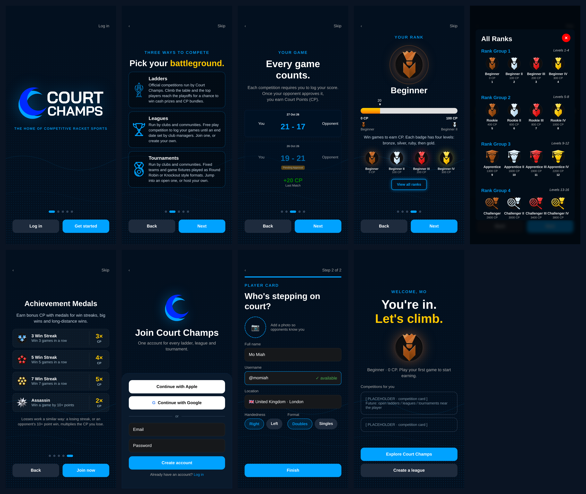

# Sign-up intro flow

Spec and mockups for the new first-run intro and sign-up flow. It reuses the design language of the ladder pre-registration How to Play guide. This file is documentation only; it contains no app code.

## Flow

The intro has five pages with page dots and Back / Next buttons, taken from `HowToPlayFlow`. Sign-up has two steps, followed by a welcome screen.

| # | Screen | Mockup |
|---|---|---|
| 1 | Brand | `01-brand.png` |
| 2 | Competitions | `02-competitions.png` |
| 3 | Every game counts | `03-compete.png` |
| 4 | Your rank (+ All Ranks modal) | `04-rank.png`, `04b-rank-details.png`, `04-rank-pulse.gif` |
| 5 | Achievement Medals | `05-medals.png` |
| 6 | Account | `06-account.png` |
| 7 | Profile (Step 2 of 2) | `07-profile.png` |
| 8 | Welcome | `08-welcome.png` |

### 1. Brand
- Shows `assets/court-champ-logo.png` (trim its transparent padding and use `resizeMode="contain"`) and the line "THE HOME OF COMPETITIVE RACKET SPORTS", the motto from the website's `HomePage.tsx`.
- Buttons: Log in / Get started.

### 2. Competitions: "Three ways to compete / Pick your battleground."
Each card uses a blue outline icon.
- **Ladders** (needs a ladder outline icon, see Open questions): "Official competitions run by Court Champs. Climb the table and the top players reach the playoffs for a chance to win cash prizes and CP bundles."
- **Leagues** (`mockImages/trophy-outline.png`): "Run by clubs and communities. Free play competition to log your games until an end date set by club managers. Join one, or create your own."
- **Tournaments** (`mockImages/medal-outline.png`): "Run by clubs and communities. Fixed teams and game fixtures played as Round Robin or Knockout style formats. Jump into an open one, or host your own."

### 3. Every game counts
- Subtitle: "Each competition requires you to log your score. Once your opponent approves it, you earn Court Points (CP)."
- Shows two singles game cards built from `components/scoreboard/ScoreboardAtoms.js` (`TeamColumn` and `ScoreDisplay`) inside the `GameContainer` card style from `Scoreboard.tsx`: background `#001123`, border `rgb(9,33,62)`, radius 8.
  - "You 21 - 17 Opponent", approved.
  - "You 19 - 21 Opponent", pending: opacity 0.6 with the "Pending Approval" label.
- Below the cards: "+20 CP / Last Match", in the style `MedalProgress` uses for the last match.

### 4. Your rank
- **Hero badge:** the current rank medal (Beginner, `rankingMedals/ranking/bronze_rank1-min.png`). It has a `PulseRing` in the rank's colour and a soft glow in the same colour.
- **Progress bar:** `components/performance/MedalProgress.js`, the component `PlayerDetailsModal` and `UserProfile` use, shown at 20 / 100 CP.
  - Bar: 20px high, background `#e0e0e0`, fill gradient `#FFD100` → `#FF7800`.
  - The fill and the arrow marker animate over 1000 ms after a 300 ms delay, and the number counts up (`AnimateNumber`).
- **Badge levels:** the current badge's four levels (bronze, silver, ruby, gold) with names and CP from `rankingMedals/ranking/ranks.js`. Each medal sits on its own colour glow with no container and no pulse.
- **"View all ranks" button:** transparent background, `#00A2FF` border with a blue glow, blue text. It opens `RankInformation` (`components/Modals/RankInformation.js`), shown in `04b-rank-details.png`.

### 5. Achievement Medals
Reuse `AchievementMedalsPage` from `components/ladder/HowToPlayFlow.tsx` as it is. The multipliers come from courtchamps-shared `computeGameXp.ts`. The final button reads "Join now".

### 6. Account: "Join Court Champs"
- App icon (`assets/court-champ-logo-icon.png`) and the subline "One account for every ladder, league and tournament."
- A bottom sheet with Apple, Google, an "or" divider, Email, Password, a "Create account" button and "Already have an account? Log in".
- It deliberately looks different from the profile step.

### 7. Profile (Step 2 of 2): "Who's stepping on court?"
- Photo, full name, username (live availability check), and location (the country/city picker from `Signup.js`).
- Two chip groups: Handedness (Right / Left) and Format (Doubles / Singles).

### 8. Welcome: "You're in. Let's climb."
- Rank medal with its glow, and "Beginner · 0 CP. Play your first game to start earning."
- "Competitions for you" shows **placeholder cards** for now, because no ladders are live yet.
- Buttons: Explore Court Champs / Create a league.

## Components to reuse
- `components/ladder/HowToPlayReveal.tsx`: `Reveal` (staggered entrance animations) and `PulseRing`.
  - `PulseRing` settings: 1800 ms loop, `Easing.out(Easing.quad)`, scale 1 → 1.45, opacity 0.6 → 0, 2px border.
- `components/ladder/HowToPlayBackdrop.tsx`: dot grid and drifting waves.
- `components/ladder/HowToPlayFlow.tsx`: `Dots`, `NavButton`, `AchievementMedalsPage`.
- `components/performance/MedalProgress.js`, `MedalDisplay.js`.
- `components/Modals/RankInformation.js`.
- `components/scoreboard/ScoreboardAtoms.js`.

## Theme tokens
- Screen background `rgb(3,16,31)`
- Blue `#00A2FF`
- Gold `#FFC800`
- Muted `#aaa`
- Body text `#c9d6e3`

## Rank glow and pulse colours
Sampled from the medal images:

| Level | Colour |
|---|---|
| Bronze | `rgb(194,106,46)` |
| Silver | `rgb(211,231,243)` |
| Ruby | `rgb(234,54,54)` |
| Gold | `rgb(249,206,40)` |

- Hero badge glow: about 22px blur at 0.55 opacity.
- Small medal glow: about 12px blur at 0.5 opacity.

## Open questions
- **Profile fields:** `handedness` and `format` preference are new fields. They need to be added to the `users` schema (courtchamps-shared types) and to the Firestore rules.
- **Ladder icon:** the repo has no outline ladder icon. The mockup uses an edge trace of `gold-ladder-v2.png`; a designer-drawn asset is needed.
- **Pulse colour per level:** the pulse and glow colour should change with the user's rank level.
- **Welcome placeholders:** the placeholder competition cards on the welcome screen need replacing with real competitions near the player.
- **Rank count:** `RankInformation` shows "Level 65", but `ranks.js` appears to have about 63 entries. Confirm the total.

## Merge order
This branch is based on `claude/ladder-pre-registration` (PR #346). Merge #346 into main first, then retarget this PR to main.
